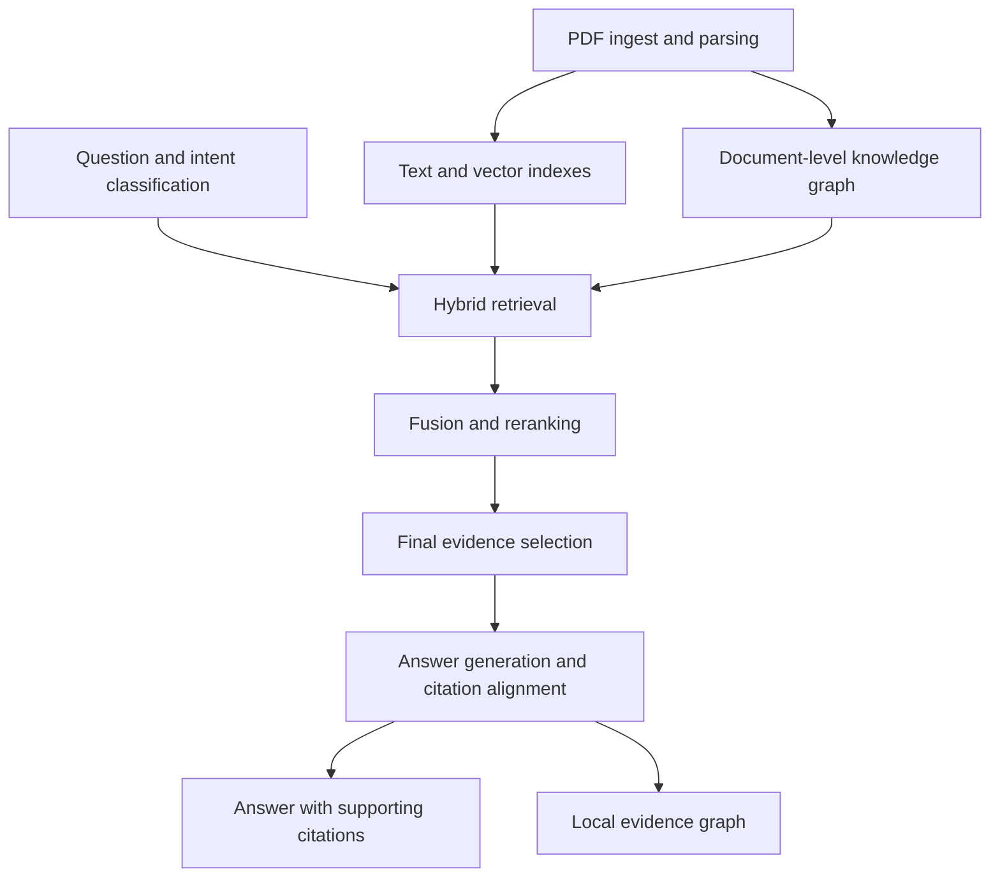

# Hybrid GraphRAG Document QA
### Final-year team project · Python / FastAPI / hybrid retrieval / evidence-grounded answers

**Jongwan Park · City University of Hong Kong · Sep 2025–May 2026**

A PDF question-answering system that returns an answer, supporting citations and a compact graph of the evidence used. My work focused on **retrieval fusion, query-intent classification, reranking, backend integration and component/integration testing**.

> **Portfolio case study:** the original implementation is a private team repository. This public page contains a project summary, not the source code, a downloadable dataset or a live demo. System-wide features below are team outcomes; my individual contributions are identified separately.

## The problem

Finding an answer in a long PDF is only part of the task. A reader also needs to inspect the evidence and understand why it supports the answer. The project combines keyword, semantic and graph-related retrieval signals, then aligns the generated response with the final evidence.

## My contribution

| Area | Individual work |
|---|---|
| Retrieval fusion | Implemented BM25 and dense-retrieval fusion |
| Query routing | Implemented query-intent classification to guide retrieval behaviour |
| Ranking | Implemented cross-encoder reranking of candidate evidence |
| Backend integration | Integrated evidence selection, answer post-processing and citation alignment into a FastAPI query pipeline |
| Testing | Conducted component and integration testing across retrieved evidence, generated answers, citations and graph context |

The complete application, frontend and team-wide evaluation work are not presented as my sole work.

## System architecture — team implementation

The design is **retrieval-first, answer-grounded and graph-explained**. The displayed graph is a local view built from final evidence, not the complete document graph and not proof of graph-first reasoning.

## Technical foundation

- **Backend:** Python and FastAPI.
- **Retrieval:** BM25, dense retrieval, ChromaDB and cross-encoder reranking.
- **Graph representation:** NetworkX and document/evidence graph structures.
- **Generation:** the current team repository describes a local Ollama `llama3.2` runtime. Configured model defaults and actual runtime wiring can differ.
- **Quality focus:** inspect evidence, answer, citation and graph consistency rather than judging fluency alone.

## Recruiter walkthrough

1. A user supplies a PDF and asks a question.
2. The system retrieves candidate evidence using complementary signals.
3. Fusion and reranking select the context for the answer.
4. The response includes citations and a local evidence graph for inspection.

This is a conceptual walkthrough of the implemented team system, not an evaluation result or a public interactive demo.

## Engineering decisions worth discussing

- **Hybrid retrieval:** keyword matches and semantic matches solve different failure cases.
- **Reranking:** evaluate relevance after candidate retrieval instead of trusting first-stage order alone.
- **Explicit intent routing:** make pipeline behaviour inspectable rather than attributing every step to an LLM.
- **Evidence alignment:** check that answer text, citations and graph context refer to consistent evidence.
- **Local graph scope:** show a focused explanation rather than an unreadable full-document graph.

## Validation and limits

My contribution included component and integration testing. This page does not claim a new benchmark run, a numerical quality improvement, hallucination-free output or production readiness. Retrieval quality, source-document structure and model behaviour still affect the result.

The source remains private to respect team ownership. No private source files, reports or document corpus are redistributed here.

[LinkedIn](https://www.linkedin.com/in/jongwan-park-8264432b5/) · [NoiseGuardian case study](https://github.com/PARK0301/showcase-noiseguardian) · [GitHub profile](https://github.com/PARK0301)
